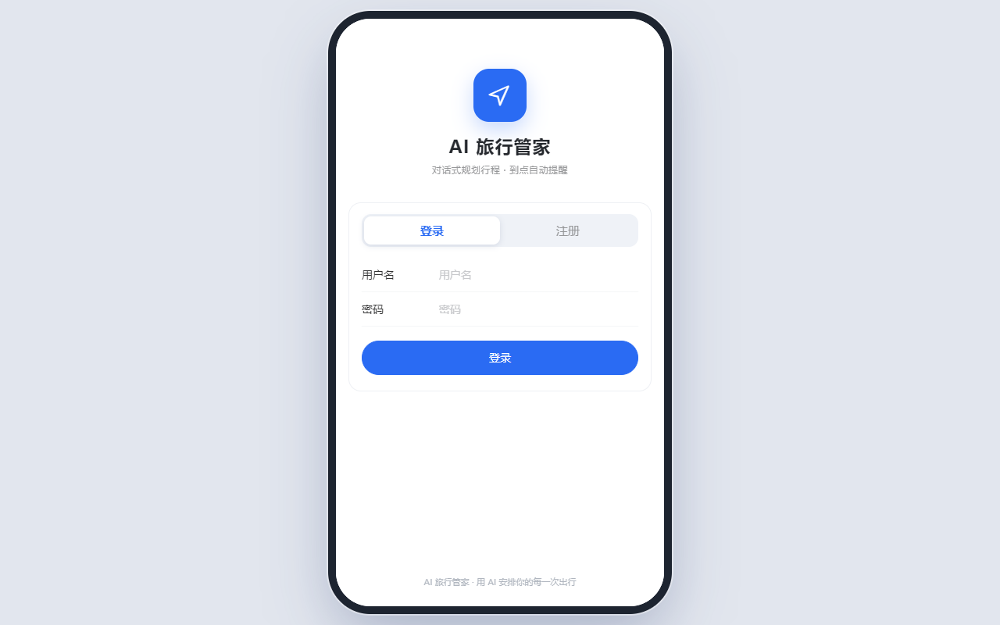
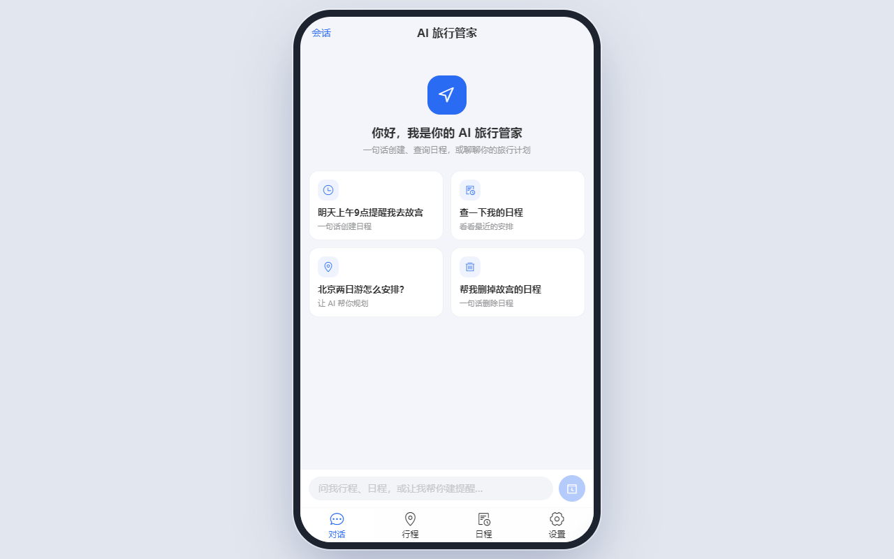
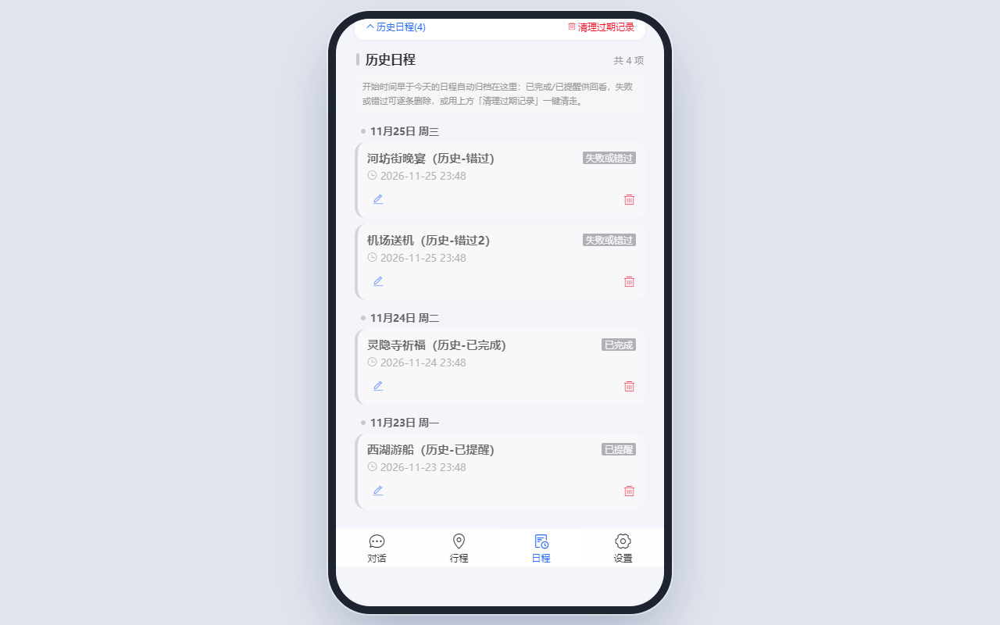
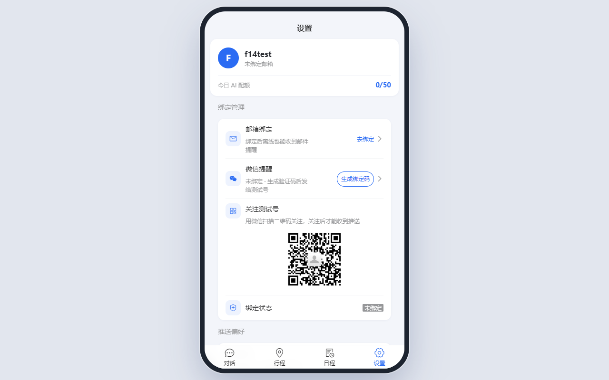
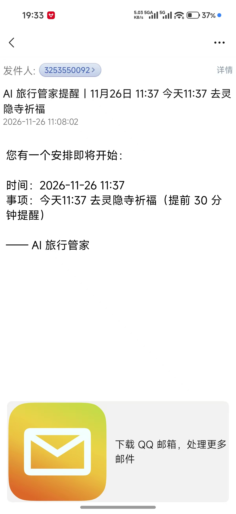
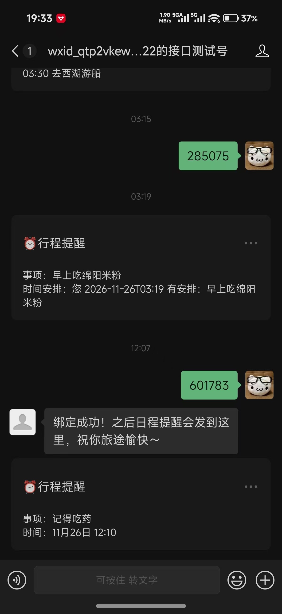
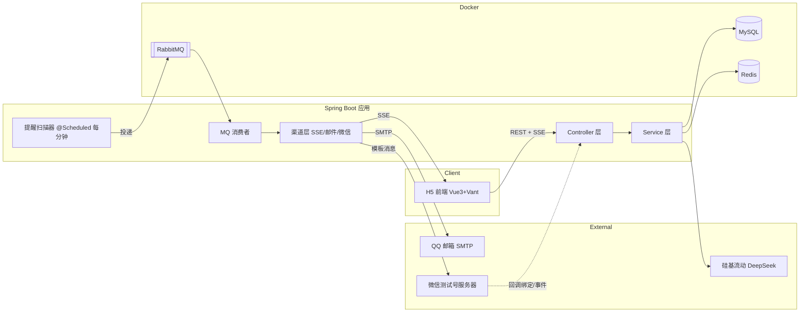
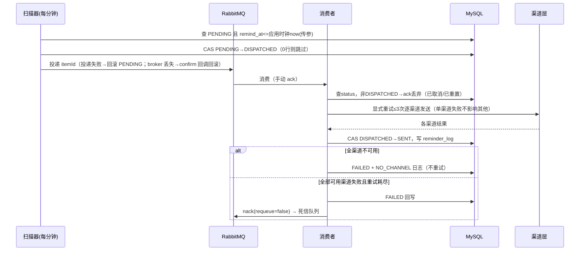

# AI 旅行管家 🧭

一个能**多轮对话**、能用**一句话操作日程**、并会在合适时机**主动提醒**的 AI 旅行助手。


> 一个 Java 后端全栈实践项目：Spring Boot 3 + MySQL + Redis + RabbitMQ + SSE + Function Calling，
> 前端为 Vue3 + Vant 手机 H5。接口契约见 [docs/API契约.md](docs/API契约.md)，系统架构与核心设计见下方「系统架构」。

## 📸 界面预览

| 登录（分段滑块切换） | 对话（Function Calling + SSE 流式） |
|  |  |
| **日程（时段分组 + 历史归档）** | **设置（绑定 + 推送偏好）** |
|  |  |

## 📱 推送实测

真实手机端验证（公网隧道 + QQ 邮箱 + 微信测试号）——验证码绑定回复、模板消息推送均已到机：

<p>
  
  
</p>

> 更多界面与验收过程截图见 [docs/验收截图/](docs/验收截图/)。

## ✨ 功能特性

**AI 对话**
- 多轮上下文对话，SSE 打字机流式输出，每用户每日配额限流
- Function Calling：一句话创建 / 删除 / 查询日程，也可开关 / 查询推送渠道（邮件/微信）并获知绑定状态
- 生成中可随时停止，断连联动取消上游 LLM 请求（止损 token）

**行程与日程**
- 行程推荐：目的地 + 天数 + 预算 + **偏好备注**（人数/忌口/不想玩什么）→ 结构化行程 JSON → 一键保存为行程并自动生成日程；生成过程有时间线进度，可后台运行
- 日程管理：时段分组展示、完成/恢复/删除/编辑（改期自动重新提醒）、历史日程归档折叠、批量清理过期记录
- 日程支持纯数字验证码绑定微信、一键复制、扫码关注引导

**主动提醒（三渠道）**
- 到期扫描 → RabbitMQ → 消费端幂等 → 多渠道通知：**页面准点弹窗（免设置、点击跳日程）/ 邮件 / 微信测试号模板消息**
- 推送偏好开关：按渠道自由启停（未绑定自动置灰），偏好关闭的渠道静默跳过
- 全渠道不可用 → FAILED + 死信队列收口；换绑微信自动迁移绑定关系

**工程化**
- 契约先行（API 契约迭代 v1→v2.8.1，独立 对抗评审）
- 后端 81 个集成/单元测试全绿；前端构建零警告
- 后端可直接托管前端构建产物（SPA 路由回退），公网隧道实测可用

## 🏗 系统架构



提醒链路时序（幂等 = DB 状态机，重试与幂等不矛盾）：



## 🧰 技术栈

| 层 | 技术 |
|---|---|
| 后端 | Java 17 · Spring Boot 3.2 · Spring Security(JWT) · MyBatis-Plus · Spring AMQP · OkHttp |
| 前端 | Vue 3.5（Composition API）· Vite 5 · Vant 4 · Axios · 原生 SSE（fetch + ReadableStream） |
| 存储/中间件 | MySQL 8 · Redis 7 · RabbitMQ 3.13（手动 ack + 死信队列） |
| 外部服务 | 硅基流动 DeepSeek（LLM）· QQ 邮箱 SMTP · 微信公众号测试号 |
| 测试 | JUnit 5 + MockMvc 集成测试 ×81（真实 MySQL/Redis 测试库） |

## 🚀 快速启动

### 0. 前置条件

- JDK 17+（项目按 17 编译）、Maven 3.9+、Node 18+
- Docker 内运行：MySQL 8（3306）、Redis（6379）、RabbitMQ（5672/15672，账号 travel/travel123）
- 全新环境可一键拉起基础设施：`docker compose -f docker-compose.infra.yml up -d`

### 1. 数据库

```sql
CREATE DATABASE ai_travel DEFAULT CHARACTER SET utf8mb4 COLLATE utf8mb4_unicode_ci;
```
然后执行 [travel-java/src/main/resources/schema.sql](travel-java/src/main/resources/schema.sql)（测试库 ai_travel_test 由测试自动初始化）。

### 2. 本地敏感配置（不入库）

在 `travel-java/` 目录下创建 `application-local.yml`（已在 .gitignore）：

```yaml
spring:
  datasource:
    password: "你的MySQL密码"
  data:
    redis:
      database: 3          # 共用实例时选一个空闲 db
  rabbitmq:
    password: "travel123"

llm:
  api-key: "你的硅基流动 API Key"

jwt:
  secret: "至少32字节的随机字符串"
```

### 3. 启动

```bash
# 后端（IDEA 直接跑 TravelJavaApplication，或：）
cd travel-java && mvn spring-boot:run
# 前端
cd travel-web && npm install && npm run dev   # http://localhost:5173
```

> 也可以不启前端 dev：后端已支持托管前端构建产物（`npm run build` 后访问 http://localhost:8080 即整站）。

### 4. 可选渠道

| 渠道 | 配置位置 | 获取方式 |
|---|---|---|
| 邮件 | `spring.mail.*` + `channels.mail: true` | QQ 邮箱设置 → 开启 SMTP → 授权码 |
| 微信 | `wechat.*` + `channels.wechat: true` | [微信公众平台测试号](https://mp.weixin.qq.com/debug/cgi-bin/sandbox?t=sandbox/login)扫码即得；回调地址需公网 80/443（标题 ≤10 字符，动态字段只在正文） |

踩坑提示：测试号**标题 ≤10 字符**且不支持动态字段；正文占位符须**逐行排布**；测试号上限 20 个关注者。

## 🔑 环境变量清单（覆盖 application-local.yml）

| 变量 | 用途 |
|---|---|
| TRAVEL_MYSQL_PASSWORD / TRAVEL_MYSQL_DATABASE | 数据源 |
| TRAVEL_REDIS_DATABASE | Redis 库位（共用实例时隔离用） |
| TRAVEL_RABBITMQ_PASSWORD | MQ |
| TRAVEL_LLM_API_KEY / TRAVEL_LLM_MODEL | 硅基流动 |
| TRAVEL_JWT_SECRET | JWT 签名（≥32 字节） |
| TRAVEL_MAIL_HOST / USERNAME / AUTH_CODE | SMTP |
| TRAVEL_WECHAT_APPID / SECRET / TOKEN / TEMPLATE_ID | 测试号 |
| TRAVEL_CHANNELS_SSE / _MAIL / _WECHAT | 渠道开关 |
| TRAVEL_CORS_ORIGINS | 跨域白名单（部署后加域名） |
| CHAT_MAX_CONVERSATIONS / CHAT_MAX_ROUNDS | 会话数上限(10) / 单会话轮数上限(20) |

## 🧪 测试

```bash
cd travel-java && mvn -s .mvn/settings.xml test
```

81 个集成/单元测试全绿，覆盖：JWT 强制下线、限流双计守卫、FC 工具循环与会话回放、提醒扫描/消费/死信、邮箱验证码全流程（冷却/每日闸/失败作废）、推送偏好过滤、**推送偏好 FC 工具（合并写入/绑定引导/端到端联动）**、微信回调验签与双格式绑定、换绑抢占、解绑、日程全状态机。

## 🎯 三大核心难点（走读）

### 难点一：SSE 流式链路治理（`service/ChatService` + `llm/LLMClient` + `api/sse.js`）

- **线程池替代裸线程**：`llmExecutor`（core4/max8/queue100），拒绝策略快速失败提示重试
- **断连取消上游**：SseEmitter 的 onCompletion/onTimeout/onError → `Handle.cancel()` → OkHttp `call.cancel()`，页面关了立刻停止白烧 token；前端 `stop()` 用 AbortController 断开 fetch
- **心跳**：对话流 15s、提醒流 30s 注释行——工具调用轮次间上游静默会超过代理超时
- **双形态响应**（契约 §3.0）：/api/chat 被拦截时返回 JSON（401/429），放行后才是 SSE，前端按 Content-Type 分流
- **ASYNC 重派发**（最容易踩的坑）：SSE 完成时容器会重派发一次请求，拦截器链重跑，限流被双倍计数——两个拦截器开头都有 `DispatcherType != REQUEST` 守卫
- **SSE 帧解析**：前端 fetch + ReadableStream 手动按行切分，处理跨 chunk 半包

### 难点二：Function Calling 工具循环（`llm/ToolRegistry` + `ChatService.executeChat`）

- 五个工具（日程的 create/delete/query + 推送偏好的开关/查询，v2.9）以 JSON Schema 注册给模型，循环最多 5 轮防死循环，超限降级为"无工具调用"逼出文本
- **工具结果永远回合法 JSON**（ok/error 结构）：业务报错不打断循环，模型自行纠偏重试
- **历史回放只取 USER 与最终 ASSISTANT**（tool_calls_json 为空）：OpenAI 协议要求 tool_calls/tool 严格配对，窗口截断切在配对中间上游直接 400——间歇性、极难排查
- **流式 tool_calls 按 index 分片组装**：DeepSeek 后续分片带 `name:""`（空串非 null），必须"非空才写入"，否则首片真名被覆盖成空串
- **system 注入当前时间**：相对时间（"明天"）换算的前提，冒烟实测过不给时间模型不调用工具
- 落库策略：USER 消息在调 LLM 前落库；工具轨迹落库不回放、不回传前端

### 难点三：提醒链路（`reminder/ReminderScanner|ReminderConsumer` + `notify/*`）

```
扫描(每分钟) → CAS PENDING→DISPATCHED → 投MQ(失败回滚/broker丢失confirm回滚)
→ 消费：查状态非 DISPATCHED 即丢弃(幂等闸门) → 显式重试≤3次逐渠道发送
→ 任一成功: CAS→SENT；全不可用: FAILED+NO_CHANNEL；全失败耗尽: FAILED+nack→DLQ
```

- **幂等为什么用 DB 状态机 CAS 而不是 Redis SETNX**：SETNX 在发送前置位，渠道失败后 MQ 重投会被"已消费"误吞——重试链路失效，提醒静默丢失；DB CAS 把"消费过"与"发送成功"绑成同一次状态迁移，重试与幂等不矛盾
- **为什么重试是显式循环而不是 spring-retry**：手动 ack 要求在监听器内 catch 异常做 nack，而容器级重试拦截器包在监听器方法外层——异常被内部 catch 吞掉，重试永远不触发（审查实测抓到的真 bug）
- **时区**：扫描 SQL 的 now 由应用层传参，不依赖 MySQL 容器时区；compose 里 TZ=Asia/Shanghai 双保险
- **渠道矩阵**（契约 §4.6）：不可用（关开关/未绑定/离线/用户偏好关闭）不参与成败判定；部分成功即 SENT；DLQ 只收"有渠道可用但全失败"的消息，人工重放前先 CAS 重置 PENDING

## 📦 部署

1. 宝塔 Docker 装 RabbitMQ（或直接用 docker-compose.infra.yml）并**改掉默认弱口令**；6379/15672 绑定 127.0.0.1 或封外网
2. `mvn -s travel-java/.mvn/settings.xml package` 产出可执行 jar → `java -jar` 运行（环境变量注入配置）；前端 `npm run build` 产物放入 `classpath:/static/`（后端内置 SPA 路由回退，无需 nginx 也可整站访问）
3. nginx 反代注意（SSE 生效的关键）：
   ```nginx
   location / {
       proxy_pass http://127.0.0.1:8080;
       proxy_buffering off;              # SSE 不缓冲
       proxy_read_timeout 120s;          # recommend 同步接口最长 60s+
       proxy_set_header Host $host;
   }
   ```
4. 微信测试号回调填公网 URL（80/443）；域名未备案先试 IP，不行用内网穿透（本项目公网联调即经内网穿透实测通过）

## 🗺 Roadmap

- [ ] Bark（iOS）/ PushPlus 推送渠道（Webhook 型，参照邮件渠道半天可接）
- [ ] 前端自动化测试（Vitest）
- [ ] Flyway 数据库迁移替代手工 schema
- [ ] ICS 日历订阅（HTTPS 部署后 webcal 一键订阅）· 小程序 · RAG 知识库 · 天气/地图 API

## ⚠️ 已知局限

- SSE 在线注册表为单机内存实现，多实例水平扩展需引入 Redis Pub/Sub 广播
- 前端无自动化测试（后端 81 用例覆盖核心链路）
- 数据库变更为手工 ALTER + schema.sql 双轨（无 Flyway 版本化迁移）
- 微信测试号上限 20 个关注者、模板有格式限制——正式运营需服务号 + 微信认证

## 📄 许可

本项目仅供学习与展示使用。
